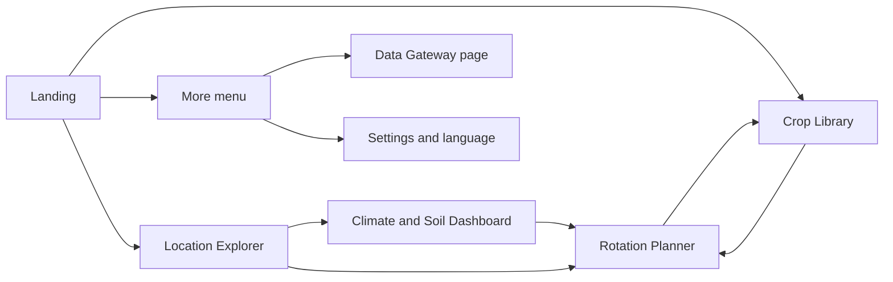
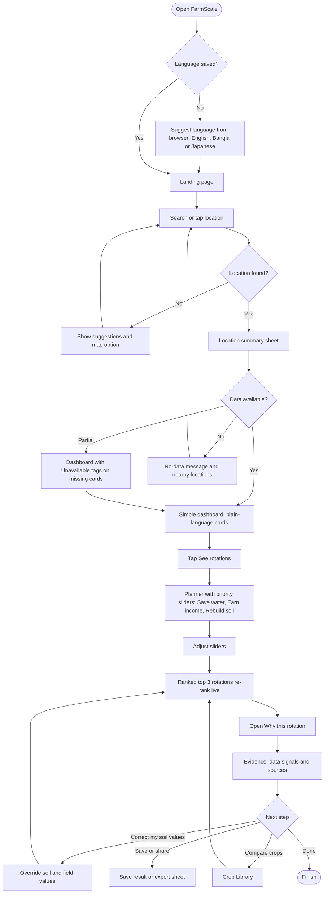
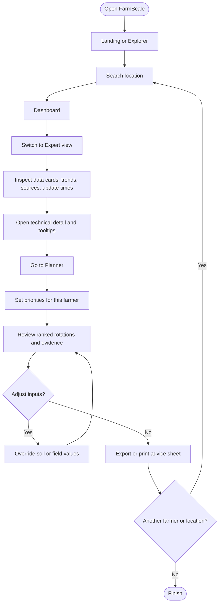
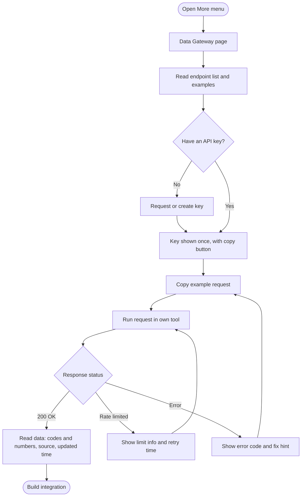
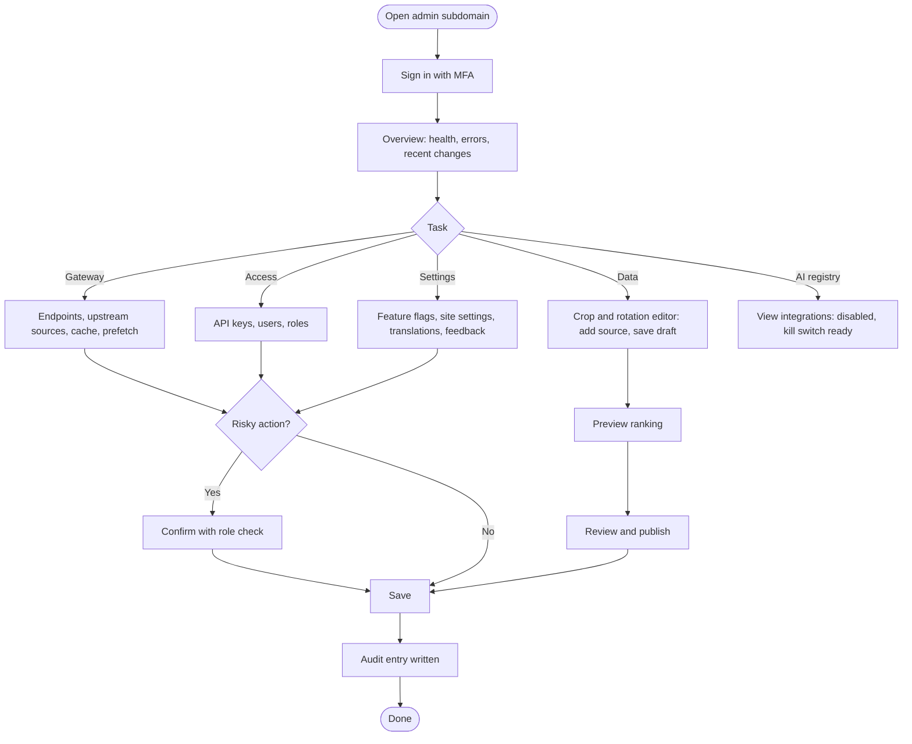
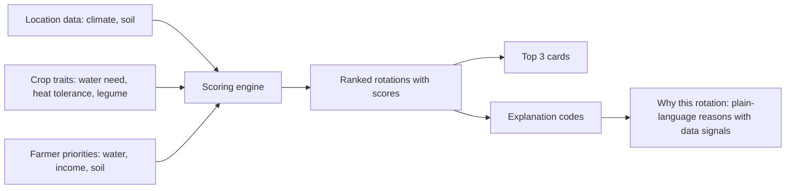
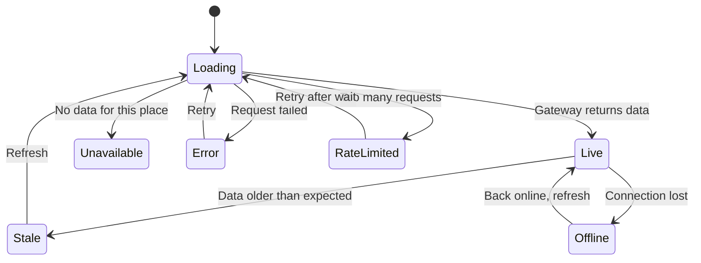
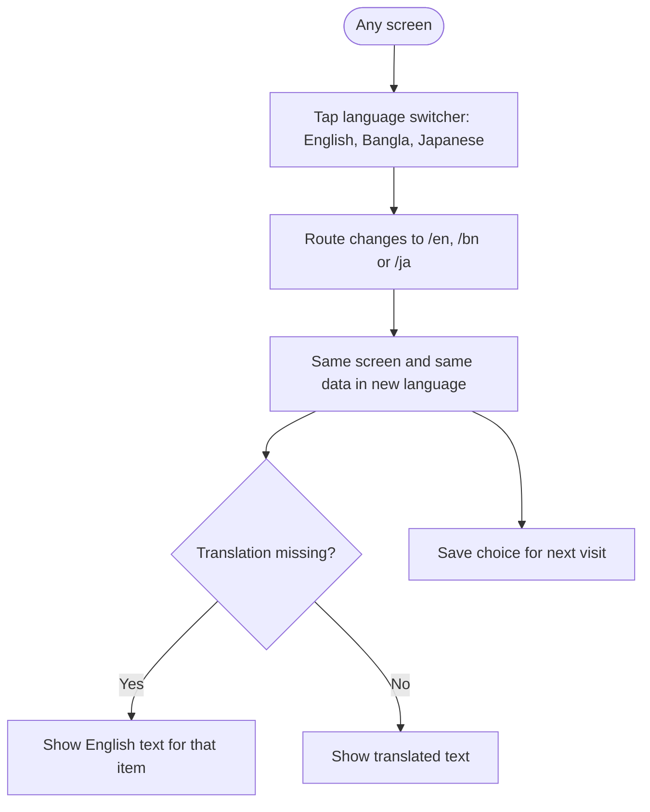
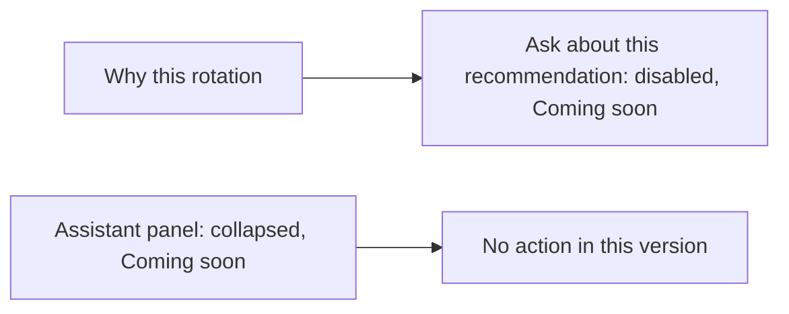

# FarmScale: User Flows

This file describes how each type of user moves through FarmScale. The diagrams use Mermaid, which renders in GitHub, GitLab, Notion, VS Code (with a Mermaid extension) and most documentation tools.

**Scope of this version:** no AI features. The assistant slot and the "Ask about this recommendation" button are visible but disabled ("Coming soon").

**Public screens:** Landing, Location Explorer, Climate and Soil Dashboard, Rotation Planner, Crop Library, Data Gateway page.
**Internal:** Admin console (separate app, see Flow D).

---

## 1. Map of all screens

Navigation: bottom tab bar on mobile (Home, Explore, Plan, Crops, More). Top navigation on tablet and desktop. The Data Gateway page lives under "More".

---

## 2. Flow A: Farmer (primary flow)

**Goal:** find my field, understand what the climate is doing, and get rotation options that fit my priorities.
**Device:** mid-range Android phone, unstable internet.
**Success:** within about 60 seconds the farmer sees a top recommendation and understands why.

**Key screens and what the farmer sees**

| Step | Screen | What happens |
|---|---|---|
| 1 | Landing | One headline, a location search box, the rotation ring, three trust points |
| 2 | Explorer | Map or search. Selecting a place opens a bottom sheet with 3-4 summary cards |
| 3 | Dashboard (Simple) | One plain sentence per card, one chart, one source label and update time |
| 4 | Planner | Three sliders. Ranked cards update live with a short animation |
| 5 | Why this rotation | The data signals behind the rank, in plain language |
| 6 | Optional | Override soil values, browse crops, save or share |

---

## 3. Flow B: Extension officer

**Goal:** advise many farmers quickly, compare locations, and explain recommendations.
**Device:** laptop or tablet. Uses Expert view.

Notes: Expert view shows technical terms with tooltips, raw values behind expand controls, and sources. The Simple view stays available so the officer can show it to the farmer.

---

## 4. Flow C: Developer or partner (data gateway)

**Goal:** get an API key and fetch climate, soil and crop data for a location.

Rules reflected here: the API is versioned (`/v1/...`), returns codes and numbers rather than sentences, and every response includes its source and an update time.

---

## 4b. Flow D: Developer or maintainer (admin console)

**Goal:** keep the platform healthy and keep data and settings up to date. Internal only, on a separate subdomain. Full spec: `ADMIN-SPEC.md`.

Rules reflected here: MFA, server-side roles, confirmation for dangerous actions, audit entry on every write, sources required for crop values, and the AI registry kept disabled.

---

## 5. Priority sliders and ranking (detail)

Behavior: moving a slider recalculates the ranking immediately. If a data input is unavailable, the card shows an Unavailable tag and the engine states which inputs it used.

---

## 6. Data states (every data card)

| State | What the user sees |
|---|---|
| Loading | Skeleton placeholder for the card |
| Live | Value, one source label, "Last updated" time |
| Sample | Value with a visible "Sample data" tag (design and demo only) |
| Unavailable | Short plain explanation and nearby alternatives |
| Stale | Value with a "Data may be old" note and a refresh action |
| Error | Plain message, error code in Expert view, Retry button |
| Rate limited | Message with a wait time |
| Offline | "Showing saved data" banner and the last known values |

---

## 7. Language switching flow

Notes: the location, priorities and results stay as they were after a language change. Dates, numbers and units are localized.

---

## 8. Reserved AI slot (not active in this version)

These are visual placeholders only. They must not call any AI service.

---

## 9. Decision points and edge cases

| Situation | Expected behavior |
|---|---|
| User denies location permission | Fall back to search and map selection |
| Location outside supported data coverage | Say what is missing and suggest the nearest supported location |
| Slow or lost connection | Show skeletons, then saved data with an "Offline" note |
| User sets all sliders to zero | Show a gentle prompt to choose at least one priority, or use equal weights and say so |
| User overrides soil values | Re-rank immediately and mark the result "Using your values" |
| Gateway rate limit reached | Show wait time, keep the last result visible |
| Unsupported language string | Show English and keep the app usable |

---

## 10. Success measures

| Measure | Target |
|---|---|
| Time from landing to first recommendation | About 60 seconds or less, without help |
| Farmer can say why the top rotation was chosen | Yes, from the "Why this rotation" text alone |
| Task completion on slow mobile connection | Works with saved data and skeleton states |
| Language switch keeps context | No lost location or priorities |